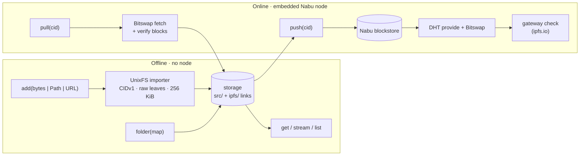

# nebulus-nabu

[](https://github.com/pedropietro/nebulus-nabu/actions/workflows/build.yml)
[](https://jitpack.io/#pedropietro/nebulus-nabu)

**Virtual IPFS for Java.** Work with IPFS files privately and offline, and publish to the
network only when you decide to.

🇧🇷 [Leia em português](README.pt-BR.md) · 🚀 [Quick Start](docs/quickstart.md)

nebulus-nabu is a Java port of [Nebulus](https://github.com/rarepress/nebulus). It runs on
[Nabu](https://github.com/pedropietro/nabu), a Java implementation of IPFS.

```java
try (Nebulus nebulus = new Nebulus()) {
    String cid = nebulus.add("Hello world".getBytes());  // computed locally, nothing is published
    nebulus.push(cid).join();                           // now it is on the public IPFS network
}
```

## Why

IPFS bundles two things: content-addressed storage and a peer-to-peer network. With a regular
node, adding a file and publishing it happen in the same step.

Nebulus separates the two, the way Git separates commit from push:

| | IPFS node | Nebulus |
|---|---|---|
| Get a CID | `ipfs add` publishes the content | `add` works offline and privately |
| Publish | Implicit | `push(cid)`, when you choose |
| Fetch | `ipfs get` | `pull(cid)` |
| Needs a running node | Always | Only for `push` and `pull` |

This makes some things easy:

- **Proof of existence.** Share or timestamp a CID first, and reveal the content later.
- **Private drafts.** Build a site or an NFT collection with CID links between files, without
  publishing each version.
- **IPFS as a data packet.** Send IPFS-addressed files over any channel, such as HTTP or email.
  The receiver can verify them by CID.
- **Ephemeral IPFS.** Push once, wait for the gateway to fetch the content, then stop seeding.

## Features

- **The same CIDs as the rest of IPFS.** They match the JavaScript Nebulus and
  `ipfs add --cid-version=1 --raw-leaves` byte for byte. The test suite checks this against
  reference vectors.
- **Files of any size.** The importer splits them into 256 KiB chunks and builds a balanced
  DAG. Content is streamed, so files are never fully loaded into memory.
- **An embedded Nabu node** for `push` and `pull`: Bitswap, Kademlia DHT, a file blockstore, and
  a peer identity that stays the same across restarts.
- **Integrity checks.** Every block received by `pull` is verified against its CID.
- **The original API:** `add`, `download`, `folder`, `get`, `stream`, `push`, `pull`, and
  global or per-CID events, plus `CompletableFuture`s for the network calls.
- **A pluggable network** through the `IpfsNetwork` interface, which is useful for tests or
  other transports.

## Installation

Requires **Java 17+**. Builds are published through [JitPack](https://jitpack.io/#pedropietro/nebulus-nabu).

**Maven**

```xml
<repositories>
  <repository>
    <id>jitpack.io</id>
    <url>https://jitpack.io</url>
  </repository>
</repositories>

<dependencies>
  <dependency>
    <groupId>com.github.pedropietro</groupId>
    <artifactId>nebulus-nabu</artifactId>
    <version>main-SNAPSHOT</version>
  </dependency>
</dependencies>
```

**Gradle**

```groovy
repositories {
    mavenCentral()
    maven { url 'https://jitpack.io' }
}
dependencies {
    implementation 'com.github.pedropietro:nebulus-nabu:main-SNAPSHOT'
}
```

`main-SNAPSHOT` follows the `main` branch. For reproducible builds, use a commit hash (the first
10 characters) as the version. The first request for a new version makes JitPack build it,
which can take a few minutes.

Next: the **[Quick Start](docs/quickstart.md)** takes about 10 minutes. It goes from your first
CID to sharing files between two nodes and publishing to the public network.

## How it works



Everything lives under one folder, `.nebulus` by default:

```
.nebulus/
├── src/<sha256>          buffers and downloads, stored once by content hash
├── ipfs/<cid>            symbolic link to the file with that CID's content
├── ipfs/<cid>/<name>     folders: one link per entry
└── repo/                 Nabu node state, created on first connect()
    ├── blocks/           the blockstore
    └── identity          the node key; keep it private
```

`add(Path)` does not copy your file. `ipfs/<cid>` points at the file where it is, so moving or
deleting the file breaks the link. Add it again to fix the link. Buffers and downloads are
copied into `src/`.

## API reference

### Writing (synchronous, offline)

| Method | Description |
|---|---|
| `String add(byte[] buffer)` | Stores the buffer in `src/` and returns its CID. |
| `String add(Path file)` | Links an existing file without copying it, and returns its CID. |
| `String add(String pathOrUrl)` | Treats the string as a file path, or downloads it if it is an `http(s)` URL. |
| `String download(String url)` | Downloads into `src/` and returns the CID. Throws `FileTooLargeException` past `maxMegabytes`. |
| `String folder(Map<String, String> nameToCid)` | Creates a flat folder from CIDs already in Nebulus and returns the folder's CID. |

### Reading (synchronous, offline)

| Method | Description |
|---|---|
| `byte[] get(String cid)` | Returns the content. Also accepts `folderCid/name` and `/ipfs/cid`. |
| `String get(String cid, Charset charset)` | Returns the content as text. |
| `InputStream stream(String cid)` | Opens the content as a stream. |
| `List<String> list(String folderCid)` | Returns the folder's entry names, sorted. |
| `boolean has(String cid)` | Tells whether the CID is available locally. |

### Network (asynchronous)

| Method | Description |
|---|---|
| `CompletableFuture<Void> connect()` | Starts the Nabu node. Optional, because `push` and `pull` connect when needed. |
| `CompletableFuture<Void> disconnect()` | Stops the node. Local files stay available. |
| `CompletableFuture<String> push(String cid)` | Publishes a file or folder. By default it completes once the gateway serves the content. |
| `CompletableFuture<String> pull(String cid)` | Fetches a file or flat folder into Nebulus. |
| `boolean isConnected()`, `Optional<String> peerId()` | Report the node's state. |
| `void close()` | Disconnects and releases threads. `Nebulus` is `AutoCloseable`. |

### Events

```java
nebulus.on("push", cid -> ...);           // every push
nebulus.on("pull:" + cid, cid -> ...);    // once, for that CID only, then removed
nebulus.off("push", listener);
```

The events are `push` and `pull`. The original's names, `upload` and `download`, are also fired
as aliases. Listeners run on a Nebulus worker thread.

### Options

```java
new Nebulus(NebulusOptions.builder()
        .path("storage")
        .maxMegabytes(100)
        .swarmAddresses(List.of("/ip4/0.0.0.0/tcp/4030"))
        .build());
```

| Option | Default | Description |
|---|---|---|
| `path` | `.nebulus` | Storage folder. |
| `maxMegabytes` | unlimited | Size limit for downloads, in MB (10⁶ bytes). |
| `symbolicLinks` | `true` | `ipfs/` entries are symbolic links. With `false` they are copies, which makes the folder self-contained. Nebulus also switches to copies when the OS refuses links. Check `usesSymbolicLinks()`. |
| `swarmAddresses` | `/ip4/0.0.0.0/tcp/4002` | libp2p listen addresses. Use a different port for each node on the same machine. |
| `bootstrapAddresses` | public libp2p bootstrap list | Initial peers. Pass an empty list for a private network. |
| `gateway` | `https://ipfs.io` | Gateway polled by `push`. |
| `verifyOnGateway` | `true` | When `false`, `push` completes right after the DHT announcement. |
| `gatewayRequestTimeout` / `gatewayPollInterval` | 10 s / 1 s | Timing of the gateway polling. |
| `pushTimeout` / `pullTimeout` | 10 min | Upper bound for each operation. `Duration.ZERO` waits forever. |
| `network` | `NabuNetwork` | A custom `IpfsNetwork` factory. |

### Errors

Synchronous methods throw `IOException`, for example `NoSuchFileException` for an unknown CID
or `FileTooLargeException`. They throw `IllegalArgumentException` for invalid folder names, or
for paths that point outside the storage folder. Futures complete exceptionally, with a
`TimeoutException` when a timeout is reached.

## Coming from the JavaScript Nebulus

| Nebulus (JS) | nebulus-nabu (Java) |
|---|---|
| `new Nebulus({ path, max, config })` | `new Nebulus(NebulusOptions.builder()…build())`. `config` becomes `swarmAddresses` and `bootstrapAddresses`. |
| `await nebulus.add(buffer \| path)` | `nebulus.add(byte[] \| Path \| String)` |
| `await nebulus.download(url)` | `nebulus.download(url)` |
| `await nebulus.folder({...})` | `nebulus.folder(Map<String, String>)` |
| `nebulus.get(cid, encoding)` / `stream(cid)` | `get(cid)`, `get(cid, charset)`, `stream(cid)` |
| `connect()`, `disconnect()`, `push(cid)`, `pull(cid)` | The same names, returning `CompletableFuture`s |
| `on(event, cb)` | `on(event, Consumer<String>)`, plus `off(...)` |

Behavior differences:

- `on` adds a listener instead of replacing the previous one. A failing listener does not stop
  the others.
- Pushing a folder publishes that folder's own CID. The original copied each file into the
  node's MFS root and checked the gateway under that root's CID instead.
- `pull` links content under the CID you asked for, so content created by other tools (CIDv0 or
  other chunkers) works too.
- `maxMegabytes` also applies when the server sends no `Content-Length`.
- Folder entry names are validated, because `pull` receives them from the network.
- On file systems without symbolic links (Windows without developer mode), files are copied
  instead.

## Limitations

- Folders are flat (depth 1), as in the original. Nested and sharded (HAMT) directories are
  rejected.
- With the default settings, `push` waits until the gateway has fetched the content. Behind NAT
  this can take minutes, or time out if no peer can reach your node. See
  [Troubleshooting](docs/quickstart.md#troubleshooting).
- Only sha2-256 blocks are verified on `pull`. Blocks with other hash functions are accepted as
  received.

## Project layout

```
src/main/java/io/github/pedropietro/nebulus/
├── Nebulus.java, NebulusOptions.java   public API
├── cid/                                 CID, base32/base58, varints
├── unixfs/                              dag-pb + UnixFS importer/exporter
└── network/                             IpfsNetwork SPI; nabu/NabuNetwork adapter
examples/quickstart/                     the Quick Start as a runnable project
src/test/java/…/demo/                    ports of the original demos
```

## Building and testing

```bash
# Nabu from JitPack
mvn verify

# or Nabu built from source (what CI does)
git clone https://github.com/pedropietro/nabu
mvn -f nabu/pom.xml install -DskipTests
mvn -Pnabu-local verify

# also run the tests against the public network and ipfs.io (slow)
mvn -Pnabu-local verify -Dnebulus.live=true
```

The suite covers CID vectors generated with the JavaScript importer, the offline API, push and
pull over an in-memory network, and two real Nabu nodes on localhost.

## License

BSD 3-Clause, see [LICENSE](LICENSE). This project is a port of Nebulus (MIT, © 2021 Skogard)
and depends on Nabu (MIT). See [NOTICE](NOTICE).
