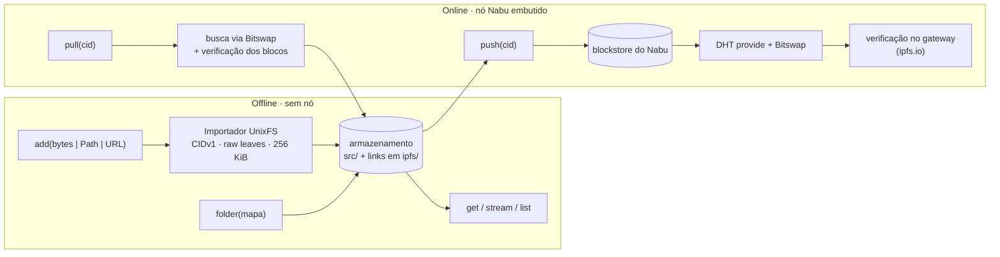

# nebulus-nabu

[](https://github.com/pedropietro/nebulus-nabu/actions/workflows/build.yml)
[](https://jitpack.io/#pedropietro/nebulus-nabu)

**IPFS virtual para Java.** Trabalhe com arquivos IPFS de forma privada e offline, e publique na
rede só quando decidir.

🇺🇸 [Read in English](README.md) · 🚀 [Guia rápido](docs/quickstart.pt-BR.md)

O nebulus-nabu é um port em Java do [Nebulus](https://github.com/rarepress/nebulus). Ele roda
sobre o [Nabu](https://github.com/pedropietro/nabu), uma implementação de IPFS em Java.

```java
try (Nebulus nebulus = new Nebulus()) {
    String cid = nebulus.add("Hello world".getBytes());  // calculado localmente, nada é publicado
    nebulus.push(cid).join();                           // agora está na rede pública do IPFS
}
```

## Por quê

O IPFS junta duas coisas: armazenamento endereçado por conteúdo e uma rede peer-to-peer. Num nó
comum, adicionar um arquivo e publicá-lo acontecem no mesmo passo.

O Nebulus separa as duas coisas, como o Git separa commit de push:

| | Nó IPFS | Nebulus |
|---|---|---|
| Obter um CID | `ipfs add` publica o conteúdo | `add` funciona offline e em privado |
| Publicar | Implícito | `push(cid)`, quando você quiser |
| Buscar | `ipfs get` | `pull(cid)` |
| Precisa de nó rodando | Sempre | Só para `push` e `pull` |

Isso facilita algumas coisas:

- **Prova de existência.** Compartilhe ou registre um CID primeiro e revele o conteúdo depois.
- **Rascunhos privados.** Monte um site ou uma coleção de NFTs com links por CID entre os
  arquivos, sem publicar cada versão.
- **IPFS como pacote de dados.** Envie arquivos endereçados por IPFS por qualquer canal, como
  HTTP ou e-mail. Quem recebe pode verificá-los pelo CID.
- **IPFS efêmero.** Publique uma vez, espere o gateway buscar o conteúdo e pare de servir.

## Recursos

- **Os mesmos CIDs do resto do IPFS.** São idênticos, byte a byte, aos do Nebulus em JavaScript e
  aos de `ipfs add --cid-version=1 --raw-leaves`. A suíte de testes confere isso contra vetores
  de referência.
- **Arquivos de qualquer tamanho.** O importador divide em pedaços de 256 KiB e monta um DAG
  balanceado. O conteúdo é lido em stream, então o arquivo nunca é carregado inteiro na memória.
- **Nó Nabu embutido** para `push` e `pull`: Bitswap, DHT Kademlia, blockstore em arquivo e uma
  identidade de peer que se mantém entre reinícios.
- **Verificação de integridade.** Todo bloco recebido no `pull` é conferido contra o seu CID.
- **A API original:** `add`, `download`, `folder`, `get`, `stream`, `push`, `pull` e eventos
  globais ou por CID, além de `CompletableFuture` nas chamadas de rede.
- **Rede plugável** pela interface `IpfsNetwork`, útil para testes ou outros transportes.

## Instalação

Requer **Java 17+**. As versões são publicadas pelo [JitPack](https://jitpack.io/#pedropietro/nebulus-nabu).

**Maven**

```xml
<repositories>
  <repository>
    <id>jitpack.io</id>
    <url>https://jitpack.io</url>
  </repository>
</repositories>

<dependencies>
  <dependency>
    <groupId>com.github.pedropietro</groupId>
    <artifactId>nebulus-nabu</artifactId>
    <version>main-SNAPSHOT</version>
  </dependency>
</dependencies>
```

**Gradle**

```groovy
repositories {
    mavenCentral()
    maven { url 'https://jitpack.io' }
}
dependencies {
    implementation 'com.github.pedropietro:nebulus-nabu:main-SNAPSHOT'
}
```

`main-SNAPSHOT` acompanha a branch `main`. Para builds reproduzíveis, use como versão um hash de
commit (os 10 primeiros caracteres). O primeiro pedido de uma versão nova faz o JitPack
compilá-la, o que pode levar alguns minutos.

Próximo passo: o **[Guia rápido](docs/quickstart.pt-BR.md)** leva uns 10 minutos. Ele vai do
primeiro CID até compartilhar arquivos entre dois nós e publicar na rede pública.

## Como funciona



Tudo fica numa pasta, `.nebulus` por padrão:

```
.nebulus/
├── src/<sha256>          buffers e downloads, guardados uma vez pelo hash do conteúdo
├── ipfs/<cid>            link simbólico para o arquivo com o conteúdo daquele CID
├── ipfs/<cid>/<nome>     pastas: um link por entrada
└── repo/                 estado do nó Nabu, criado no primeiro connect()
    ├── blocks/           o blockstore
    └── identity          a chave do nó; mantenha em sigilo
```

O `add(Path)` não copia o seu arquivo. O `ipfs/<cid>` aponta para o arquivo onde ele está, então
mover ou apagar o arquivo quebra o link. Adicione o arquivo de novo para refazer o link. Buffers e
downloads são copiados para `src/`.

## Referência da API

### Escrita (síncrona, offline)

| Método | Descrição |
|---|---|
| `String add(byte[] buffer)` | Grava o buffer em `src/` e retorna o CID. |
| `String add(Path arquivo)` | Cria um link para o arquivo existente, sem copiá-lo, e retorna o CID. |
| `String add(String caminhoOuUrl)` | Trata a string como caminho de arquivo, ou baixa o conteúdo se for uma URL `http(s)`. |
| `String download(String url)` | Baixa para `src/` e retorna o CID. Lança `FileTooLargeException` acima de `maxMegabytes`. |
| `String folder(Map<String, String> nomeParaCid)` | Cria uma pasta plana a partir de CIDs que já estão no Nebulus e retorna o CID da pasta. |

### Leitura (síncrona, offline)

| Método | Descrição |
|---|---|
| `byte[] get(String cid)` | Retorna o conteúdo. Também aceita `cidDaPasta/nome` e `/ipfs/cid`. |
| `String get(String cid, Charset charset)` | Retorna o conteúdo como texto. |
| `InputStream stream(String cid)` | Abre o conteúdo como stream. |
| `List<String> list(String cidDaPasta)` | Retorna os nomes das entradas da pasta, em ordem. |
| `boolean has(String cid)` | Informa se o CID está disponível localmente. |

### Rede (assíncrona)

| Método | Descrição |
|---|---|
| `CompletableFuture<Void> connect()` | Inicia o nó Nabu. É opcional, porque `push` e `pull` conectam quando precisam. |
| `CompletableFuture<Void> disconnect()` | Para o nó. Os arquivos locais continuam disponíveis. |
| `CompletableFuture<String> push(String cid)` | Publica um arquivo ou uma pasta. Por padrão, termina quando o gateway passa a servir o conteúdo. |
| `CompletableFuture<String> pull(String cid)` | Traz um arquivo ou uma pasta plana para o Nebulus. |
| `boolean isConnected()`, `Optional<String> peerId()` | Informam o estado do nó. |
| `void close()` | Desconecta e libera as threads. `Nebulus` é `AutoCloseable`. |

### Eventos

```java
nebulus.on("push", cid -> ...);           // a cada push
nebulus.on("pull:" + cid, cid -> ...);    // uma vez, só para esse CID, depois é removido
nebulus.off("push", listener);
```

Os eventos são `push` e `pull`. Os nomes do original, `upload` e `download`, também são
disparados como aliases. Os listeners rodam numa thread de trabalho do Nebulus.

### Opções

```java
new Nebulus(NebulusOptions.builder()
        .path("storage")
        .maxMegabytes(100)
        .swarmAddresses(List.of("/ip4/0.0.0.0/tcp/4030"))
        .build());
```

| Opção | Padrão | Descrição |
|---|---|---|
| `path` | `.nebulus` | Pasta de armazenamento. |
| `maxMegabytes` | sem limite | Limite de tamanho dos downloads, em MB (10⁶ bytes). |
| `swarmAddresses` | `/ip4/0.0.0.0/tcp/4002` | Endereços libp2p em que o nó escuta. Use uma porta diferente para cada nó na mesma máquina. |
| `bootstrapAddresses` | lista pública de bootstrap da libp2p | Peers iniciais. Passe uma lista vazia para uma rede privada. |
| `gateway` | `https://ipfs.io` | Gateway consultado pelo `push`. |
| `verifyOnGateway` | `true` | Com `false`, o `push` termina logo depois do anúncio na DHT. |
| `gatewayRequestTimeout` / `gatewayPollInterval` | 10 s / 1 s | Tempos da consulta ao gateway. |
| `pushTimeout` / `pullTimeout` | 10 min | Limite de cada operação. `Duration.ZERO` espera para sempre. |
| `network` | `NabuNetwork` | Fábrica de `IpfsNetwork` personalizada. |

### Erros

Os métodos síncronos lançam `IOException`, por exemplo `NoSuchFileException` para um CID
desconhecido ou `FileTooLargeException`. Lançam `IllegalArgumentException` para nomes de pasta
inválidos ou para caminhos que apontam para fora da pasta de armazenamento. Os futures terminam
com exceção, com `TimeoutException` quando um limite de tempo é atingido.

## Vindo do Nebulus em JavaScript

| Nebulus (JS) | nebulus-nabu (Java) |
|---|---|
| `new Nebulus({ path, max, config })` | `new Nebulus(NebulusOptions.builder()…build())`. O `config` vira `swarmAddresses` e `bootstrapAddresses`. |
| `await nebulus.add(buffer \| path)` | `nebulus.add(byte[] \| Path \| String)` |
| `await nebulus.download(url)` | `nebulus.download(url)` |
| `await nebulus.folder({...})` | `nebulus.folder(Map<String, String>)` |
| `nebulus.get(cid, encoding)` / `stream(cid)` | `get(cid)`, `get(cid, charset)`, `stream(cid)` |
| `connect()`, `disconnect()`, `push(cid)`, `pull(cid)` | Os mesmos nomes, retornando `CompletableFuture` |
| `on(event, cb)` | `on(event, Consumer<String>)`, mais `off(...)` |

Diferenças de comportamento:

- `on` adiciona um listener em vez de substituir o anterior. Um listener que falha não impede os
  outros.
- O push de uma pasta publica o CID da própria pasta. O original copiava cada arquivo para a raiz
  do MFS do nó e verificava o gateway sob o CID dessa raiz.
- O `pull` cria o link com o CID que você pediu, então conteúdo criado por outras ferramentas
  (CIDv0 ou outros chunkers) também funciona.
- O `maxMegabytes` também vale quando o servidor não envia `Content-Length`.
- Os nomes das entradas de pasta são validados, porque o `pull` os recebe da rede.
- Em sistemas de arquivos sem links simbólicos (Windows sem modo de desenvolvedor), os arquivos
  são copiados.

## Limitações

- As pastas são planas (um nível), como no original. Pastas aninhadas e fragmentadas (HAMT) são
  rejeitadas.
- Com as opções padrão, o `push` espera o gateway buscar o conteúdo. Atrás de NAT isso pode levar
  minutos, ou estourar o tempo se nenhum peer conseguir alcançar o seu nó. Veja
  [Solução de problemas](docs/quickstart.pt-BR.md#solução-de-problemas).
- No `pull`, só blocos sha2-256 são verificados. Blocos com outras funções de hash são aceitos
  como chegam.

## Estrutura do projeto

```
src/main/java/io/github/pedropietro/nebulus/
├── Nebulus.java, NebulusOptions.java   API pública
├── cid/                                 CID, base32/base58, varints
├── unixfs/                              dag-pb + importador/exportador UnixFS
└── network/                             SPI IpfsNetwork; adaptador nabu/NabuNetwork
examples/quickstart/                     o guia rápido como projeto executável
src/test/java/…/demo/                    ports dos demos originais
```

## Build e testes

```bash
# Nabu pelo JitPack
mvn verify

# ou Nabu compilado do código-fonte (como o CI faz)
git clone https://github.com/pedropietro/nabu
mvn -f nabu/pom.xml install -DskipTests
mvn -Pnabu-local verify

# também roda os testes contra a rede pública e o ipfs.io (lento)
mvn -Pnabu-local verify -Dnebulus.live=true
```

A suíte cobre vetores de CID gerados com o importador em JavaScript, a API offline, push e pull
numa rede em memória e dois nós Nabu reais em localhost.

## Licença

BSD 3-Clause, veja [LICENSE](LICENSE). Este projeto é um port do Nebulus (MIT, © 2021 Skogard) e
depende do Nabu (MIT). Veja [NOTICE](NOTICE).
